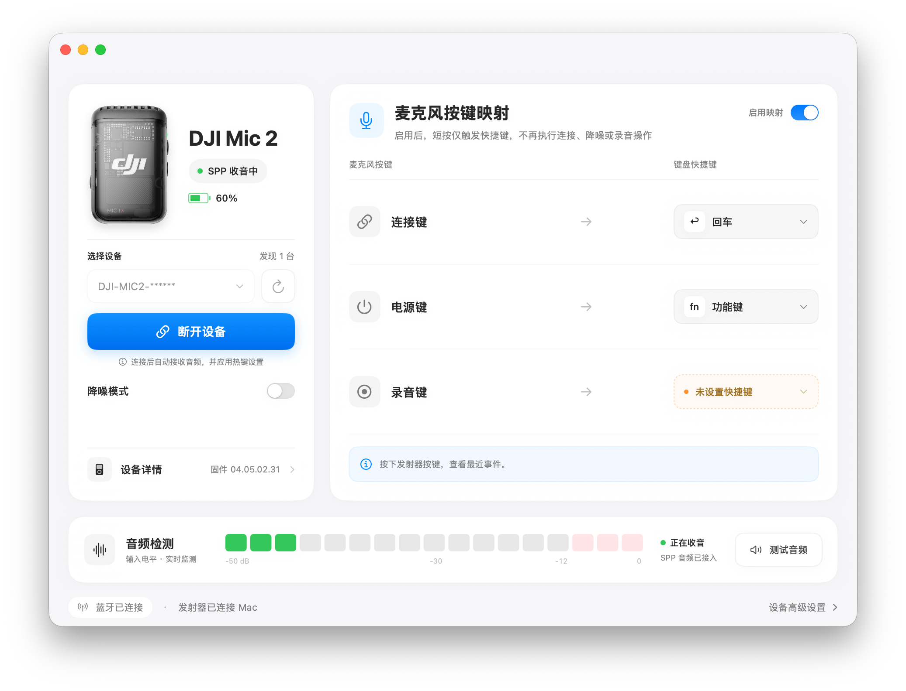

# MicBridge

[简体中文](README.md) · [Build](docs/BUILDING.md) · [Contributing](CONTRIBUTING.md)

A native macOS app that receives audio directly from a **DJI Mic 2 / Mic Mini / Mic Mini 2 transmitter over Bluetooth SPP**, without a hardware receiver. Current release: **0.5.1**; main additionally includes first-generation Mic Mini support pending hardware validation. Independent community project; not affiliated with DJI.

> **Development status:** This is an experimental development version intended only for research and development testing. **It is not suitable for production use.** Connections, audio routing, and device compatibility may be unstable. Users should assess the risks and be prepared to diagnose and resolve issues themselves.



*Screenshot of MicBridge in use, with the device-name suffix redacted; showing SPP audio reception, battery level, button mappings, and live audio monitoring.*

Main's **0.6.1 development build** adds optional Mini 2 MBRG r2 support: four independent single/double-click hotkeys, enabled only after a fresh SPP capability response. Device Information contains an expandable advanced-mode section and a separate firmware window for installing r2 or restoring the exact official 02.03.17.00 image, with preparation steps, progress and percentage. The main mapping toggle alone controls the temporary button mode after capability detection. Complete DJI firmware is not bundled. The new app flashing flow requires hardware acceptance separately from the successful Demo tests; restoration requires working BLE and is not a brick-recovery method. See [usage](docs/USAGE.md).

## Features

- 48 kHz mono decoding, live meters, segmented WAV recording and playback.
- System microphone output through the separate **MicBridge Audio** HAL driver; existing BlackHole 2ch is also supported.
- Mic 2 hotkey mode maps independent `04/68` short-press events to Mac shortcuts, with blue icon and arrow feedback.
- Mic 2 per-device mapping preference applied on connection; disabling it restores the original button functions. Long-press power-off remains available.
- Mic 2 app-controlled noise reduction with readback verification, usable alongside hotkey mode.
- Mic 2 firmware and battery queries; battery refreshes every two minutes after the initial query.
- Mic 2 retains its two quit choices. Mini 2 uses one quit flow that restores button functions and attempts SPP exit; local teardown does not wait for an RFCOMM close notification.
- During SPP connection only, keep the default input on MicBridge Audio and reject DJI output/alert routes while accepting other outputs. Disconnecting releases protection.
- Left- or right-click the menu bar icon to open the menu and select an output device.

Mic 2 (firmware 04.05.02.31) and Mini 2 (Demo-tested firmware 02.03.17.00) have separate SPP adapters. First-generation Mini now shares the Mini-family SPP adapter based on firmware 02.03.17.00 analysis; hardware validation is pending. Its connection and power hotkeys both use a single click; the power hotkey is also inferred from actual noise-reduction changes. Mic 3 remains a placeholder. Mini 2 maps a connection-button single click and a power-button double click; the latter is inferred from a noise-reduction state change and still changes actual noise reduction. Its mapping toggle only controls shortcut dispatch, without factory mode. On main, Advanced Diagnostics adds Off/Basic/Strong noise reduction for both Mini generations and Standard/Rich/Bright voice tone for Mini 2; these new controls still require hardware validation. Battery percentages are estimates derived from seven SPP status bands. Before the first connection, the app attempts a read-only BLE firmware query, caches the result per device, and disconnects BLE before opening SPP. Cached connections skip BLE. Deployment target: macOS 13+, with Xcode / Swift 5.10+ required to build. Hardware and OS coverage is limited; see [validation](docs/VALIDATION.md).

## Device support on main

This describes development **0.6.1**, not all features in the published 0.5.1 installers.

| Device / firmware | Validation | SPP audio | Hotkeys | Battery / firmware | Audio settings |
| --- | --- | --- | --- | --- | --- |
| Mic 2 / 04.05.02.31 | Core features hardware-tested | 48 kHz mono | Three independent short presses; long-press power-off preserved | SPP percentage / SPP query | Noise reduction on/off tested |
| Mic Mini (first generation) / 02.03.17.00 | Firmware-based implementation; no hardware validation | 48 kHz path implemented, unverified | Connection single press and power single press; power inferred from noise-reduction changes | SPP bands / BLE query and cache, unverified | Off/basic/strong noise reduction unverified; no tone controls |
| Mic Mini 2 stock / 02.03.17.00 | Audio, two hotkeys and metadata tested | 48 kHz mono | Connection single press and power double press; latter still toggles noise reduction | SPP bands / BLE query and cache | Off/basic/strong noise reduction and standard/rich/bright tone; new controls and all settings need full acceptance |
| Mic Mini 2 + MBRG r2 | Demo four-key/audio/restoration tests passed; integrated into App | 48 kHz mono, recording while pressing keys tested | Four independent single/double-click events; long-press power-off preserved | Same metadata path; patch capability checked each SPP session | Same settings; App controls noise reduction during key mode |
| Mic Mini 2S | Firmware research only; not integrated | Unsupported | Unsupported | Unsupported | Unsupported |
| Mic 3 | Model listing only | Unsupported | Unsupported | Unsupported | Unsupported |

Four-key mode requires the patch. Complete DJI firmware is not distributed, and the App flashing window still needs separate hardware acceptance. Mini battery percentages are band estimates; cached firmware is not queried live every session. The 48 kHz claim applies to SPP, not native HFP.

Mic 2 MTU 666 remains unresolved. After HFP interference, Mini 2 may need another connection attempt; local teardown is not a complete reconnection fix. Default route protection cannot prevent another application from directly opening DJI endpoints.

## Cloud builds and releases

The **Build and release** GitHub Actions workflow builds directly from the repository, including device artwork, without personal Apple certificates. Releases are triggered only by pushing a `v<version>` tag matching the app version; the workflow publishes a pre-release only after tests and package verification succeed. See the [release workflow](docs/RELEASING.md).

## Build

From the repository root:

```sh
swift test
python3 scripts/check-micbridge-transport.py
swift build -c release --product MicBridge
```

To package the app, run `bash scripts/build-micbridge.sh`. Builds default to ad-hoc signing and never automatically select a personal certificate. Personal signing requires explicitly setting `MICBRIDGE_SIGNING_IDENTITY`. See [build instructions](docs/BUILDING.md) for driver and installer builds. Run `bash scripts/build-micbridge-release.sh` to generate separate Apple Silicon (arm64) and Intel (x86_64) development-test installers, each including the audio driver. The release script uses ad-hoc signatures for the app/driver and unsigned, unnotarized installers, without personal Apple certificates. These local artifacts are not automatically published. Development previews are available from [GitHub Releases](https://github.com/conradwhitmore/DJI-Mic-Bridge/releases). See the installation steps below.

## Install

Requires macOS 13 or later.

1. Download the package matching your Mac from [GitHub Releases](https://github.com/conradwhitmore/DJI-Mic-Bridge/releases):
   - **Apple Silicon / M series**: `MicBridge-<version>-AppleSilicon.pkg`
   - **Intel**: `MicBridge-<version>-Intel.pkg`
2. To update an existing installation, choose “Quit for now” from MicBridge before running the new installer. Uninstalling first is not required.
3. Open the `.pkg` and follow the installer, including administrator authorization. Both the app and **MicBridge Audio** driver are included; BlackHole is not required.
4. Restart as prompted by the installer, then open MicBridge from Applications.
5. Grant Bluetooth, microphone, or Accessibility permissions if macOS requests them for the features you use. Hotkey mapping requires Accessibility permission.

The app and driver are ad-hoc signed; the installer is unsigned and unnotarized. **Only if macOS blocks opening it**, go to System Settings → Privacy & Security → Open Anyway and confirm. If no warning appears, continue normally; no extra approval is needed. Do not disable SIP or Gatekeeper.

## Use

**Known issue: firmware information may fail to load on first connection. Try reconnecting Bluetooth and restarting Mic 2.**

Install the audio driver and restart macOS for first use. Pair Mic 2 with the Mac, connect it from MicBridge, then select **MicBridge Audio** in the receiving application. Avoid opening the native DJI HFP input or output while SPP is active. Default-route protection cannot prevent applications from explicitly selecting DJI audio endpoints.

Stopping a recording keeps SPP open. Disabling mapping restores ordinary button functions while SPP continues. Quitting restores button functions first; “Quit for now” preserves reconnect information and does not send `12/65`. Disconnecting or choosing ordinary microphone recovery uses acknowledged `12/65` cleanup. A brief Bluetooth disconnect may occur; power-cycling the transmitter after exit is the more stable recovery path observed for normal HFP use.

## Known issue: RFCOMM MTU 666 (unresolved)

Some Mic 2 connections negotiate **RFCOMM MTU 666**. In affected sessions observed so far, SPP audio levels may appear while firmware, battery, or physical-button events are missing; recordings may also drop words or contain discontinuities. **A moving audio meter does not establish that the session or recording is complete.**

MTU 667 has been observed in working sessions, but the full conditions behind abnormal negotiation are not yet understood. There is no reliable automatic recovery or compatibility fix. Reconnecting Bluetooth and restarting Mic 2 are temporary troubleshooting steps, not guaranteed fixes. Bypassing status checks has not resolved the audio integrity problem.

Contributions from developers familiar with **Bluetooth Classic / RFCOMM, the macOS Bluetooth stack, or embedded protocols** are welcome. Please share reproducible steps, findings, or proposed fixes through [Issues](https://github.com/conradwhitmore/DJI-Mic-Bridge/issues) or a pull request. Include macOS, app and firmware versions, the connection sequence, and sanitized logs; remove Bluetooth addresses, serial numbers, pairing information, and personal audio.

## Uninstall

These steps remove the app and MicBridge Audio driver while preserving recordings, preferences, and other audio drivers.

1. Disable launch at login in MicBridge settings.
2. If reinstalling, choose “Quit for now.” If you are no longer using MicBridge and want ordinary Bluetooth microphone operation, choose the quit option that restores ordinary microphone mode, wait for the app to exit, then turn off Mic 2.
3. Open Terminal on the Mac you want to uninstall from and run:

```sh
sudo rm -rf "/Applications/MicBridge.app"
sudo rm -rf "/Library/Audio/Plug-Ins/HAL/MicBridgeAudio.driver"
sudo pkgutil --forget org.dji-mic-rxless.micbridge.installer
```

Enter your Mac login password when prompted; no characters appear while typing. If the last command reports no installation receipt, you can ignore it.

4. Restart the Mac. `MicBridge Audio` will disappear from the audio device list.

## Licensing and source distribution

Original code: [MIT](LICENSE). Google liblc3: Apache-2.0. The separate BlackHole-derived driver: GPL-3.0, with corresponding modified source included in generated distributions. See [third-party notices](THIRD_PARTY_NOTICES.md).

Builds include the device artwork tracked in the repository. Images and trademarks belong to their respective owners and are not covered by the original-code MIT license. Sources are recorded in `Resources/MicBridge/Devices/SOURCES.json`. Do not publish raw audio, Bluetooth addresses, pairing material or private logs.
