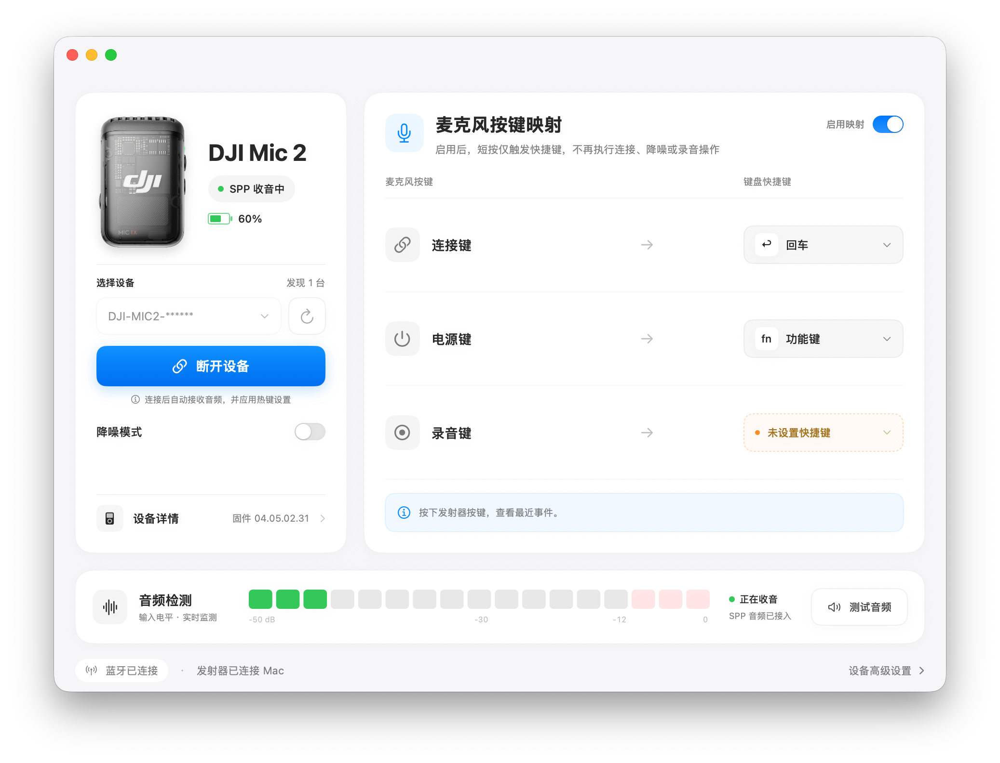

# MicBridge

[简体中文](README.md) · [Build](docs/BUILDING.md) · [Contributing](CONTRIBUTING.md)

A native macOS app that receives audio directly from a **DJI Mic 2 / Mic Mini 2 transmitter over Bluetooth SPP**, without a hardware receiver. Current development version: **0.5.1**. Independent community project; not affiliated with DJI.

> **Development status:** This is an experimental development version intended only for research and development testing. **It is not suitable for production use.** Connections, audio routing, and device compatibility may be unstable. Users should assess the risks and be prepared to diagnose and resolve issues themselves.



*Screenshot of MicBridge in use, with the device-name suffix redacted; showing SPP audio reception, battery level, button mappings, and live audio monitoring.*

## Features

- 48 kHz mono decoding, live meters, segmented WAV recording and playback.
- System microphone output through the separate **MicBridge Audio** HAL driver; existing BlackHole 2ch is also supported.
- Mic 2 hotkey mode maps independent `04/68` short-press events to Mac shortcuts, with blue icon and arrow feedback.
- Mic 2 per-device mapping preference applied on connection; disabling it restores the original button functions. Long-press power-off remains available.
- Mic 2 app-controlled noise reduction with readback verification, usable alongside hotkey mode.
- Mic 2 firmware and battery queries; battery refreshes every two minutes after the initial query.
- Restore ordinary button functions before quitting; quit for now without `12/65`, or restore ordinary microphone mode with acknowledged `12/65` shutdown. Menu bar residence and login-item configuration are included.

Mic 2 (firmware 04.05.02.31) and Mini 2 (Demo-tested firmware 02.03.17.00) have separate SPP adapters. Mini and Mic 3 remain placeholders. Mini 2 maps a connection-button single click and a power-button double click; the latter is inferred from a noise-reduction state change and still changes actual noise reduction. Its mapping toggle only controls shortcut dispatch, without factory mode or a software noise-reduction switch. Battery percentages are estimates derived from seven SPP status bands. Before the first connection, the app attempts a read-only BLE firmware query, caches the result per device, and disconnects BLE before opening SPP. Cached connections skip BLE. Deployment target: macOS 13+, with Xcode / Swift 5.10+ required to build. Hardware and OS coverage is limited; see [validation](docs/VALIDATION.md).

## Cloud builds and releases

The **Build and release** GitHub Actions workflow builds directly from the repository, including device artwork, without personal Apple certificates. Run it manually on `main` to download build artifacts. Pushing a `v<version>` tag matching the app version publishes a pre-release only after tests and package verification succeed. See the [release workflow](docs/RELEASING.md).

## Build

From the repository root:

```sh
swift test
python3 scripts/check-micbridge-transport.py
swift build -c release --product MicBridge
```

To package the app, run `bash scripts/build-micbridge.sh`. Builds default to ad-hoc signing and never automatically select a personal certificate. Personal signing requires explicitly setting `MICBRIDGE_SIGNING_IDENTITY`. See [build instructions](docs/BUILDING.md) for driver and installer builds. Run `bash scripts/build-micbridge-release.sh` to generate separate Apple Silicon (arm64) and Intel (x86_64) development-test installers, each including the audio driver. The release script uses ad-hoc signatures for the app/driver and unsigned, unnotarized installers, without personal Apple certificates. These local artifacts are not automatically published. Development previews are available from [GitHub Releases](https://github.com/conradwhitmore/DJI-Mic-Bridge/releases). See the installation steps below.

## Install

Requires macOS 13 or later.

1. Download the package matching your Mac from [GitHub Releases](https://github.com/conradwhitmore/DJI-Mic-Bridge/releases):
   - **Apple Silicon / M series**: `MicBridge-<version>-AppleSilicon.pkg`
   - **Intel**: `MicBridge-<version>-Intel.pkg`
2. To update an existing installation, choose “Quit for now” from MicBridge before running the new installer. Uninstalling first is not required.
3. Open the `.pkg` and follow the installer, including administrator authorization. Both the app and **MicBridge Audio** driver are included; BlackHole is not required.
4. Restart as prompted by the installer, then open MicBridge from Applications.
5. Grant Bluetooth, microphone, or Accessibility permissions if macOS requests them for the features you use. Hotkey mapping requires Accessibility permission.

The app and driver are ad-hoc signed; the installer is unsigned and unnotarized. **Only if macOS blocks opening it**, go to System Settings → Privacy & Security → Open Anyway and confirm. If no warning appears, continue normally; no extra approval is needed. Do not disable SIP or Gatekeeper.

## Use

**Known issue: firmware information may fail to load on first connection. Try reconnecting Bluetooth and restarting Mic 2.**

Install the audio driver and restart macOS for first use. Pair Mic 2 with the Mac, connect it from MicBridge, then select **MicBridge Audio** in the receiving application. Avoid opening the native DJI HFP input or output while SPP is active. Default-route protection cannot prevent applications from explicitly selecting DJI audio endpoints.

Stopping a recording keeps SPP open. Disabling mapping restores ordinary button functions while SPP continues. Quitting restores button functions first; “Quit for now” preserves reconnect information and does not send `12/65`. Disconnecting or choosing ordinary microphone recovery uses acknowledged `12/65` cleanup. A brief Bluetooth disconnect may occur; power-cycling the transmitter after exit is the more stable recovery path observed for normal HFP use.

## Known issue: RFCOMM MTU 666 (unresolved)

Some Mic 2 connections negotiate **RFCOMM MTU 666**. In affected sessions observed so far, SPP audio levels may appear while firmware, battery, or physical-button events are missing; recordings may also drop words or contain discontinuities. **A moving audio meter does not establish that the session or recording is complete.**

MTU 667 has been observed in working sessions, but the full conditions behind abnormal negotiation are not yet understood. There is no reliable automatic recovery or compatibility fix. Reconnecting Bluetooth and restarting Mic 2 are temporary troubleshooting steps, not guaranteed fixes. Bypassing status checks has not resolved the audio integrity problem.

Contributions from developers familiar with **Bluetooth Classic / RFCOMM, the macOS Bluetooth stack, or embedded protocols** are welcome. Please share reproducible steps, findings, or proposed fixes through [Issues](https://github.com/conradwhitmore/DJI-Mic-Bridge/issues) or a pull request. Include macOS, app and firmware versions, the connection sequence, and sanitized logs; remove Bluetooth addresses, serial numbers, pairing information, and personal audio.

## Uninstall

These steps remove the app and MicBridge Audio driver while preserving recordings, preferences, and other audio drivers.

1. Disable launch at login in MicBridge settings.
2. If reinstalling, choose “Quit for now.” If you are no longer using MicBridge and want ordinary Bluetooth microphone operation, choose the quit option that restores ordinary microphone mode, wait for the app to exit, then turn off Mic 2.
3. Open Terminal on the Mac you want to uninstall from and run:

```sh
sudo rm -rf "/Applications/MicBridge.app"
sudo rm -rf "/Library/Audio/Plug-Ins/HAL/MicBridgeAudio.driver"
sudo pkgutil --forget org.dji-mic-rxless.micbridge.installer
```

Enter your Mac login password when prompted; no characters appear while typing. If the last command reports no installation receipt, you can ignore it.

4. Restart the Mac. `MicBridge Audio` will disappear from the audio device list.

## Licensing and source distribution

Original code: [MIT](LICENSE). Google liblc3: Apache-2.0. The separate BlackHole-derived driver: GPL-3.0, with corresponding modified source included in generated distributions. See [third-party notices](THIRD_PARTY_NOTICES.md).

Builds include the device artwork tracked in the repository. Images and trademarks belong to their respective owners and are not covered by the original-code MIT license. Sources are recorded in `Resources/MicBridge/Devices/SOURCES.json`. Do not publish raw audio, Bluetooth addresses, pairing material or private logs.
