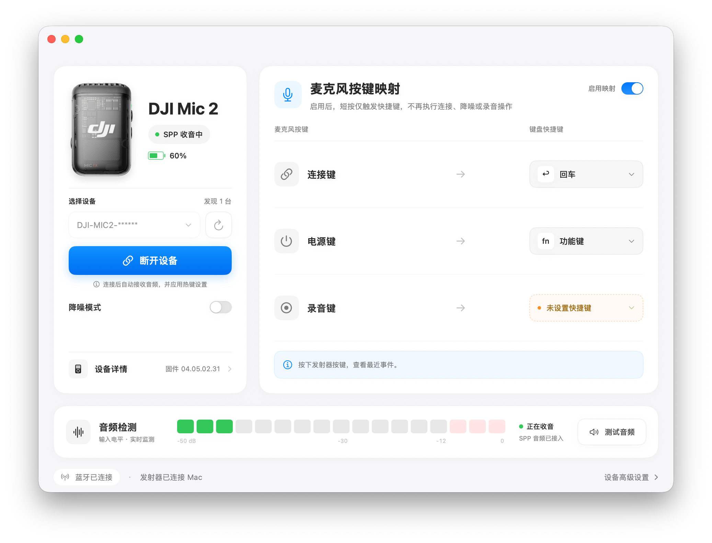

# MicBridge

[English](README.en.md) · [构建](docs/BUILDING.md) · [使用](docs/USAGE.md) · [协议](docs/PROTOCOL.md) · [贡献](CONTRIBUTING.md)

原生 macOS 应用，通过蓝牙 SPP 直接接收 **DJI Mic 2 发射器**的声音，无需硬件接收器。项目包含菜单栏 App、独立虚拟音频驱动，以及保留的研究 Demo。

当前开发版本：**0.4.2**。这是独立的社区互操作项目，与 DJI 无隶属或背书关系。

> **开发状态说明：** 当前为实验性开发版本，仅供研究与开发测试，**不适用于生产环境**。连接、音频路由及设备兼容性仍可能存在不稳定情况，使用者需自行评估风险，并具备排查和处理问题的能力。



*MicBridge 实际运行截图：设备名称后缀已脱敏；展示 SPP 收音、设备电量、按键映射与实时音频监测。*

## 已实现

- SPP 音频解码为 48 kHz 单声道 PCM，实时电平、分段 WAV 录音和回放。
- 通过 **MicBridge Audio** 驱动向其他软件提供系统麦克风输入；兼容已有 BlackHole 2ch。
- 热键模式通过 `04/68` 独立事件，将连接键、电源键、录音键短按映射到自定义 Mac 快捷键；对应图标与箭头同步亮蓝。
- “启用映射”开关按设备记忆，连接后自动应用；关闭后恢复原按键功能，长按电源仍可关机。
- App 内可切换“降噪模式”，支持与热键模式同时使用，并回读确认设置。
- 连接后读取固件和电量，电量每 **2 分钟**更新。
- 退出前先恢复普通按键功能；“仅本次退出”不发送 `12/65`，恢复普通麦克风则发送 `12/65` 并收到匹配的 `ACK 00` 后关闭 SPP；手动断开执行后者。
- 菜单栏常驻、左键打开主窗口、右键菜单、登录启动配置。

## 设备支持

| 发射器 | 当前支持 |
| --- | --- |
| DJI Mic 2 | SPP 收音、录音、按键监听、电量读取；实机固件 04.05.02.31 |
| Mic Mini / Mini 2 / Mic 3 | 仅型号展示；暂不支持连接与指令 |

App 声明支持 macOS 13+；构建需要 Xcode / Swift 5.10+。Apple Silicon 已有本机实测；Intel 提供交叉编译的独立安装包，仍需实机验收。设备及系统覆盖仍有限。离线测试不能代替真实硬件验收，详见 [验证范围](docs/VALIDATION.md)。

## 安装

系统要求：macOS 13 或更新版本。

1. 从 [GitHub Releases](https://github.com/conradwhitmore/DJI-Mic-Bridge/releases) 下载与你的 Mac 芯片匹配的安装包：
   - **M 系列 / Apple Silicon**：`MicBridge-<版本号>-AppleSilicon.pkg`
   - **Intel**：`MicBridge-<版本号>-Intel.pkg`
2. 如果已安装旧版，先在 MicBridge 菜单中选择“仅本次退出”，再直接安装新包，无需先卸载。
3. 双击 `.pkg`，按安装器提示完成安装和管理员授权。安装包包含 App 与 **MicBridge Audio** 驱动，无需另外安装 BlackHole。
4. 按安装器提示重启 Mac，然后从“应用程序”打开 MicBridge。
5. 使用时如系统请求蓝牙、麦克风或辅助功能权限，按所需功能允许；热键映射需要辅助功能权限。

App 和驱动使用 ad-hoc 签名，pkg 未签名、未经 Apple 公证。**仅当 macOS 阻止打开时**，进入“系统设置 → 隐私与安全性”，点击“仍要打开”并确认；没有拦截提示时直接继续，无需额外操作。无需关闭 SIP 或 Gatekeeper。

## 开始使用

**已知问题：首次连接可能无法获取固件版本，可尝试重新连接蓝牙并重启 Mic 2 后重试，详见下方 MTU 666 问题。**

1. 将 Mic 2 与 Mac 蓝牙配对，其他接收设备保持断开。
2. 打开 MicBridge，点击“连接设备”，等待电平与固件信息。
3. 在录音、会议或语音软件中选择 **MicBridge Audio**，不要选择 DJI 原生蓝牙音频端点。
4. 停止录音只结束文件保存；恢复普通麦克风使用“断开设备”，或菜单退出中的“不再使用，恢复普通麦克风”。

SPP 与 DJI 的 HFP 音频可能冲突。App 会保护默认音频路由，但无法阻止其他软件直接打开 DJI 输入或输出。退出 SPP 后可能有蓝牙短暂断连；需要普通蓝牙录音时，关机再开机是已验证较稳定的恢复方式。参见 [使用说明](docs/USAGE.md) 和 [恢复说明](docs/RECOVERY.md)。

## 已知问题：RFCOMM MTU 666（尚未解决）

部分 Mic 2 连接会协商到 **RFCOMM MTU 666**。在已观察到的异常会话中，App 可以显示 SPP 音频电平，但固件、电量或物理按键事件可能缺失，录音也可能丢字、不连续。**有电平不代表连接和录音完整可用。**

正常会话中曾观察到 MTU 667，但目前尚未确定触发异常协商的完整条件，也没有可靠的自动恢复或兼容方案。重新连接蓝牙并重启 Mic 2 可以作为临时尝试，不能保证恢复；简单绕过状态检查也未解决音频完整性问题。

欢迎熟悉 **Bluetooth Classic / RFCOMM、macOS 蓝牙栈或嵌入式协议**的开发者协助定位。如果有相关经验、可重复的复现步骤或修复思路，请通过 [Issues](https://github.com/conradwhitmore/DJI-Mic-Bridge/issues) 或 Pull Request 交流。反馈时可附 macOS / App / Mic 固件版本、连接操作顺序及脱敏日志，请移除蓝牙地址、设备序列号、配对信息和个人音频。

## 卸载

以下操作移除 App 与 MicBridge Audio 驱动，保留录音文件、个人设置和其他音频驱动。

1. 在 MicBridge 设置中关闭开机自启。
2. 如果只是准备重新安装，选择“仅本次退出”；如果不再使用 MicBridge、准备恢复普通蓝牙麦克风，选择“不再使用，恢复普通麦克风”，等退出完成后关闭 Mic 2。
3. 在需要卸载的 Mac 上打开“终端”，执行：

```sh
sudo rm -rf "/Applications/MicBridge.app"
sudo rm -rf "/Library/Audio/Plug-Ins/HAL/MicBridgeAudio.driver"
sudo pkgutil --forget org.dji-mic-rxless.micbridge.installer
```

按提示输入 Mac 登录密码，输入时不会显示字符。若最后一条提示找不到安装记录，可忽略。

4. 重启 Mac，`MicBridge Audio` 将从音频设备列表中移除。

## 云端构建与发布

GitHub Actions 的 **Build and release** 工作流直接从仓库构建，保留设备渲染图，无需个人 Apple 证书。手动选择 `main` 运行可下载构建产物；推送与 App 版本一致的 `v<版本号>` 标签后，测试和安装包校验通过才会自动发布 Pre-release。详见 [发布流程](docs/RELEASING.md)。

## 本地构建与检查

在仓库根目录执行：

```sh
swift test
python3 scripts/check-micbridge-transport.py
swift build -c release --product MicBridge
```

以上命令不安装驱动、不连接麦克风。构建 App 包默认使用 ad-hoc 签名，不会自动读取个人证书：

```sh
bash scripts/build-micbridge.sh
```

产物为 `dist/MicBridge.app`。签名、安装包、CPU 架构和研究 Demo 的说明见 [BUILDING](docs/BUILDING.md)。

## 仓库结构

```text
Sources/MicBridge/          macOS App 与设备会话
Sources/MicBridgeSupport/   状态、快捷键、退出和恢复策略
Sources/MicLinkCore/        SPP / DUML、LC3 解码、按键及 WAV
Sources/CBridgeAudio/       实时音频缓冲
Sources/RXlessDemo/         独立研究 Demo
Tests/                     离线测试
Vendor/                    固定版本依赖及许可证
Resources/                 App 图标、元数据和可选产品图
scripts/                   构建、校验和独立诊断工具
packaging/                 安装器资源与安装前检查
docs/                      使用、协议、架构和发布说明
```

## 许可与公开源码

原创代码采用 [MIT](LICENSE)；Google liblc3 为 Apache-2.0；独立 MicBridge Audio 驱动基于 GPL-3.0 的 BlackHole。分发驱动时必须保留其许可并提供相应修改源码，构建脚本已包含源码包生成。完整归属见 [第三方说明](THIRD_PARTY_NOTICES.md)。

构建包含仓库中的设备渲染图，图片与商标的权利归其各自所有者，不适用原创代码的 MIT 授权。来源见 `Resources/MicBridge/Devices/SOURCES.json`。原始录音、固件、蓝牙地址、系统日志和本机交接材料不属于公开源码。

问题反馈请附最小复现、App / macOS / 固件版本及脱敏日志；不要上传原始语音或配对凭据。参见 [贡献指南](CONTRIBUTING.md)、[安全报告](SECURITY.md) 和 [路线图](docs/ROADMAP.md)。
